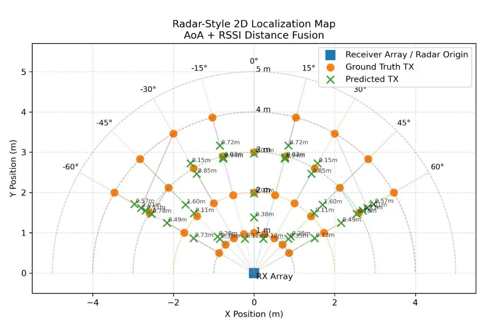
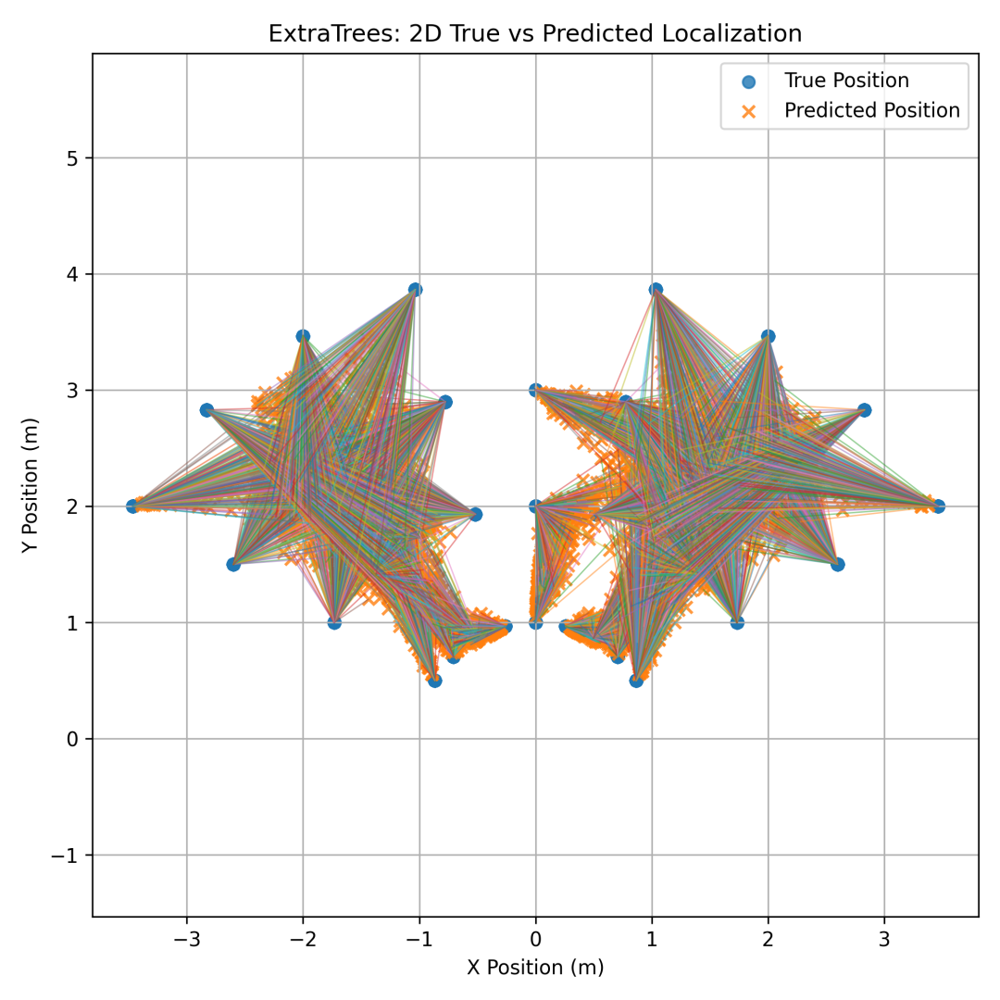
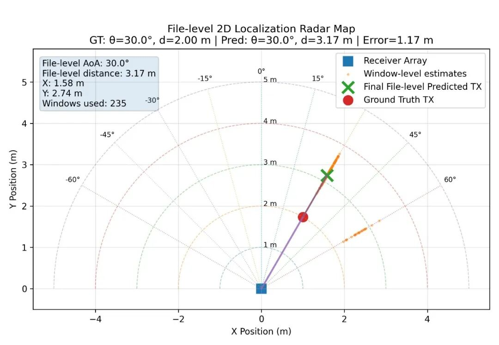
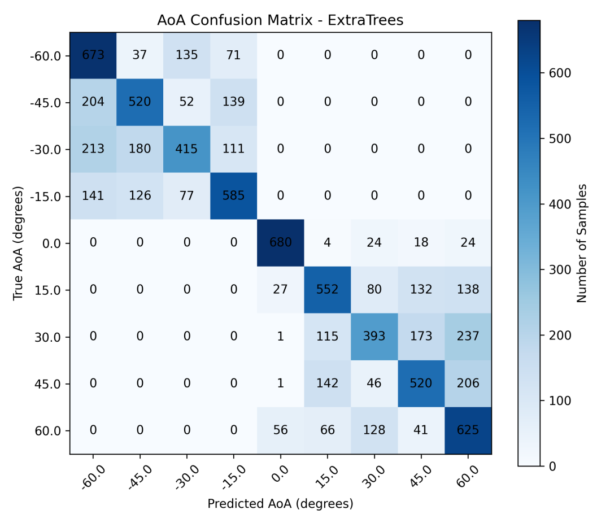

# [Hardcore Technology] Unveiling the New Paradigm of High Precision 2D Positioning: The Principles and Implementation of PGDB-HML-FC Model [with Python code attached]

[Hardcore Technology] Unveiling the New Paradigm of High Precision 2D Positioning: The Principles and Implementation of PGDB-HML-FC Model in a Complicated Wireless Environment, How to Achieve Centimeter-Level Precision Indoor Positioning? This has always been a challenging issue faced by both academia and industry. Traditional GPS fails indoors, while fingerprint positioning based on Wi-Fi or Bluetooth is often affected by environmental changes.
Today, we will delve into a novel positioning model known as PGDB-HML-FC (Phase-Geometry Distance-Branch Hybrid Machine Learning with Feedback Correction), which cleverly integrates signal phase geometry and distance decay characteristics. Through a feedback loop mechanism, it achieves astonishing levels of positioning accuracy.
I. Physical Foundation: Everything from positioning to IQ data, all the way back to the source of all positioning, originates from the raw IQ (In-phase/Quadrature) signals received by the receiver (RX).
1. The basic signal of the signal is a complex number, consisting of both the in-phase component and the quadrature component:
2. Key feature extraction: To locate, we need to extract two core physical quantities from the IQ signal: RSSI (Received Signal Strength Indicator): used for distance estimation.
Phase difference (): used to estimate angle. Calculate the phase difference between two antennas to receive signals:
3. Geometric solutions are based on phase differences, which allows us to calculate the angle of arrival: where is the wavelength and is the antenna spacing.
In the end, by combining distance and angle, we can obtain the 2D position of the target through polar coordinate conversion:
II. Core Methodology: PGDB-HML-FC Architecture Our model is not merely reliant on simple physical formulas, but rather, it constructs an end-to-end machine learning pipeline. Its core innovation lies in the dual-branch modeling and feedback correction.
1. Data preprocessing and feature engineering experiments have a strict hierarchical structure: frequency → distance → antenna pair → angle → file
Original IQ data flows through the following steps for cleaning and refining:
Metadata generation: Establish data indexing.
Preprocessing and windowing: Clean and segment the IQ data of TX (transmitter) and RX (receiver).
TX-RX Calibration: Eliminate phase deviation introduced by hardware.
Multi-pair feature extraction: The system does not rely solely on a pair of antennas, but instead extracts features from four pairs (Pairs (1,4), (2,3), (1,3), (2,4)) RX antennas. These include AoA, RSSI, and SCM (Spatial Covariance Matrix) features.
Feature fusion: Merge the features of four pairs of antennas to construct a high-dimensional feature space.
2. The dual-branch modeling strategy does not directly regress coordinates, but decouples the problem into two subproblems, which are handled by specialized models respectively:
AoA branch: Using the Extra Trees (extremely randomized trees) model, focusing on learning a nonlinear mapping between phase and angle.
Distance branch: Using the XGBoost model, focusing on learning the complex relationship between RSSI and distance.
3. Hybrid positioning and feedback correction is the soul of PGDB-HML-FC. The system combines the angle of AoA branch prediction with the distance branch prediction to perform a preliminary 2D positioning. Subsequently, a feedback correction loop is introduced, using the prediction results to inversely correct the features, ultimately outputting high-precision transmitter positions.
III. Engineering Implementation: Full-Process Automation
The entire process includes more than 20 key steps, mainly divided into four stages:
Data preparation phase checks the integrity of IQ files.
Generate metadata, preprocess IQ data.
Windowing processing and TX-RX calibration.
Feature engineering phase parallel extraction of features for pairs of antennas (Pair 14, 23, 13, 24).
Merge all features and partition training set / validation set / test set.
Model training phase trains core components: Extra Trees (AoA), XGBoost (Distance).
Trains main model: Proposed PGDB-HML-FC.
Trains baseline contrast models: Random Forest, MLP, Direct XY Regression, etc., to prove the superiority of the new model.
Evaluation and visualization phase evaluates angle error, distance error, and final XY positioning error from different perspectives.
Generates comparison tables and visualization charts.
IV. Experimental setup and data
To ensure the rigorousness of the experiment, we have constructed a standardized dataset structure:
Frequency: 850MHz
Bandwidth: 1M
File example:
TX: data/raw_iq/tx/850MHz/1M/(1,3)/-60/tx_ref.csv
RX: data/raw_iq/rx/850MHz/1M/(1,3)/-60/rep01.csv
This fine folder management ensures that experimental data can be traceable and reproducible under different frequencies, distances, and angles.
V. Summary
The PGDB-HML-FC model achieves breakthrough performance through the following strategies:
1. Multi-antenna fusion: Leveraging four pairs of antenna features greatly enriches spatial information.
2. Task decoupling: Modeling angle and distance separately, choosing the most suitable algorithm to avoid the disadvantage of single models being difficult to accommodate different physical characteristics.
3. Feedback mechanism: Closed-loop optimization, further reducing errors.
In the future, wireless positioning systems will no longer rely solely on traditional triangulation but will evolve towards a hybrid intelligent approach that integrates physical perception with data-driven decision-making. PGDB-HML-FC is a prime example of this trend.  
For those interested in more details about the code implementation or model comparison results, feel free to leave a comment below!

## Images

<!-- PAYMENT_BLOCK -->

## Get this dataset

- Payment link (Stripe): [Buy now](https://buy.stripe.com/3cs8yP7sY87d0vu9AB)
- Payment QR code: 

<!-- /PAYMENT_BLOCK -->
